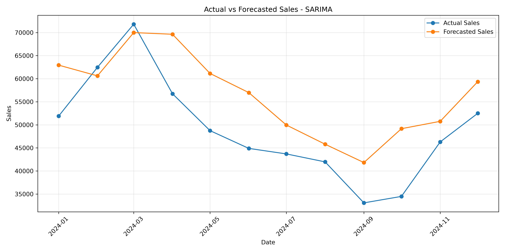
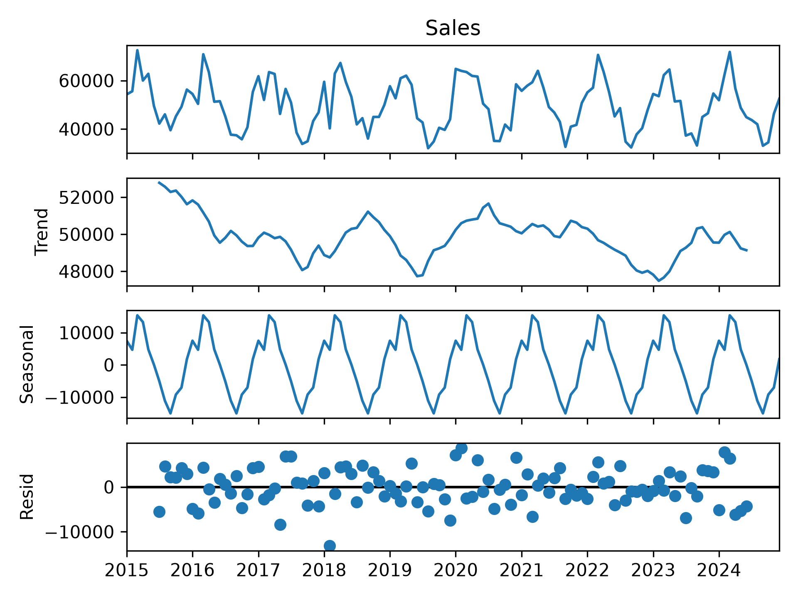

# Sales Forecasting Project

## Project Overview

This project focuses on forecasting future sales using historical retail sales data. The goal is to analyze past sales, identify trends and seasonal patterns, and predict future sales using a time-series forecasting model.

## Objectives

- Clean and prepare the sales data
- Analyze monthly sales
- Identify trends and seasonal patterns
- Build a sales forecasting model
- Compare actual sales with forecasted sales
- Evaluate the forecasting model using error metrics

## Technologies Used

- Python
- Pandas
- NumPy
- Matplotlib
- Scikit-learn
- Statsmodels
- VS Code

## Dataset

The dataset contains retail sales information with the following columns:

- Date
- Store
- Category
- Sales

The daily sales data was converted into monthly sales totals for time-series analysis.

## Data Analysis

The sales data was converted into monthly sales and analyzed to identify:

- Overall sales trends
- Repeating seasonal patterns
- Changes in sales over time

Seasonal decomposition was used to separate the data into:

- Observed Sales
- Trend
- Seasonality
- Residuals

## Forecasting Model

The project uses the **SARIMA (Seasonal ARIMA)** model.

Model configuration:

- ARIMA order: (1, 1, 1)
- Seasonal order: (1, 1, 1, 12)
- Seasonal period: 12 months

The last 12 months of the dataset were kept as test data to evaluate the forecasting model.

## Model Evaluation

The model was evaluated using:

- MAE (Mean Absolute Error)
- RMSE (Root Mean Squared Error)
- MAPE (Mean Absolute Percentage Error)

### Results

- MAE: 8076
- RMSE: 9162
- MAPE: 18.08%

These metrics show the forecasting error between the actual and predicted sales for the 12-month test period.

## Project Visualizations

### Actual vs Forecasted Sales

The project compares actual sales with the sales predicted by the SARIMA model.



### Trend and Seasonality Analysis

Seasonal decomposition is used to visualize the trend, seasonal pattern, and residuals in the sales data.



## Project Structure

```text
sales_forecasting/
│
├── sales_data.csv
├── sales_forecasting.py
├── seasonality_analysis.py
├── forecast.png
├── seasonality.png
└── README.md